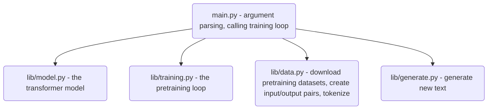

# Pretraining transformers from scratch

## Architecture



## Running

Run the code:

```bash
uv run main.py
```

Checks before committing:

```bash
uvx ty check && uvx ruff check --fix && uv run pytest
```